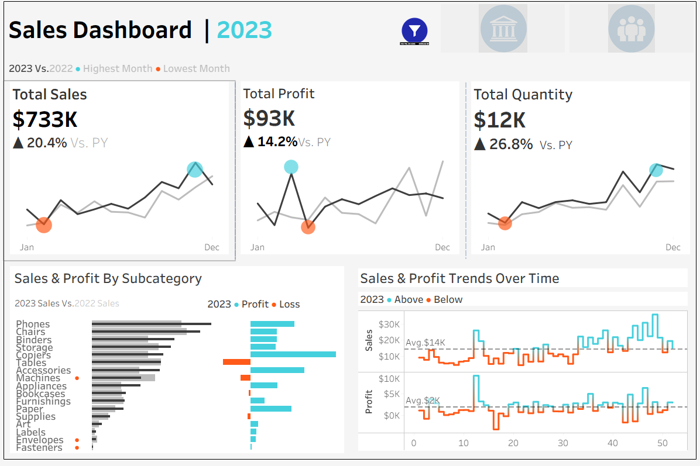

# Sales Performance Dashboard Analysis | Tableau

An interactive **Tableau Dashboard** designed to analyze Sales data, track key performance indicators (KPIs), and uncover insights into sales demographics.

## 📊 Project Overview
This repository contains an end-to-end **Sales Analytics Dashboard** built using **Tableau**. The goal of this project is to transform raw transactional sales data into an interactive, executive-level business intelligence tool. By tracking key revenue, profit, and customer metrics, this dashboard enables stakeholders to identify growth opportunities, monitor regional performance, and optimize product pricing strategies.

🔗 **Live Interactive Dashboard:** [View on Tableau Public]()

## 🎯 Business Objectives
* **Monitor Core KPIs:** Track Total Sales, Net Profit, Profit Margin, and Total Quantity Sold with Year-over-Year (YoY) comparisons.
* **Identify Seasonal Trends:** Analyze monthly and quarterly revenue fluctuations to forecast demand and manage inventory.
* **Evaluate Product & Category Performance:** Pinpoint top-performing sub-categories and identify loss-making products caused by heavy discounting.
* **Analyze Regional & Segment Distribution:** Compare profitability across different geographic territories and customer segments (Consumer, Corporate, Home Office).

## 🛠️ Tools & Techniques Used
* **Visualization Tool:** Tableau Desktop / Tableau Public
* **Data Source:** Sample Superstore Dataset / Retail Sales CSV / SQL Database
* **Key Tableau Features Implemented:**
  * Calculated Fields & Level of Detail (LOD) Expressions (`FIXED`, `INCLUDE`)
  * Dynamic Parameters (Metric Switchers for Sales vs. Profit)
  * Interactive Dashboard Actions (Filter & Highlight Actions)
  * Dual-Axis Charts, Filled Maps, and KPI Cards (BANs)

**How to Use**:
1. **Download**: Download the Excel file from this repository.
2. **Data Input**: Input your own sales data into the "Data Sheet" or replace existing data.
3. **Analysis**: Navigate through different sheets to analyze various aspects of your sales.
4. **Charts**: Charts and graphs are dynamically linked to the data.

**Contributing**:

Contributions are welcome! If you have any suggestions for improving the analysis or adding new features, feel free to fork this repository, make your changes, and submit a pull request.

**Acknowledgments**:

- Inspiration: This analysis was inspired by the need for better understanding sales trends and performance.
- Data Source: 

**Feedback**:

If you have any feedback, questions, or concerns, please feel free to open an issue in this repository or contact ME at bhartisonawane30@gmail.com
Thank you for using Sales Analysis Tableau! Enjoy analyzing your sales data and discovering insights to improve your business.
